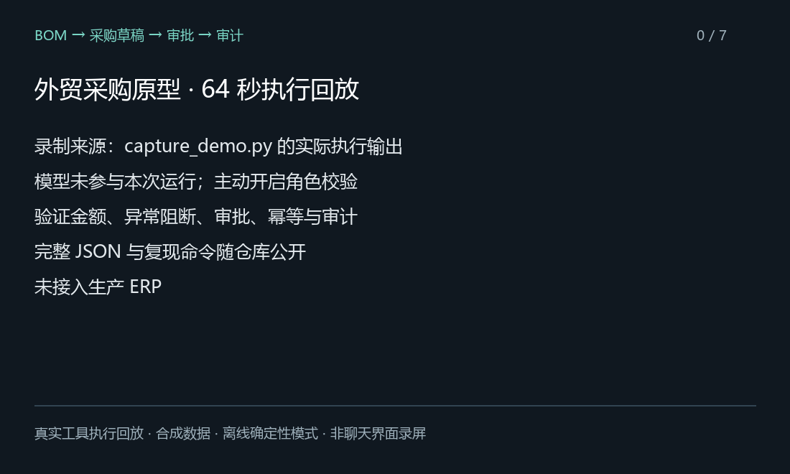
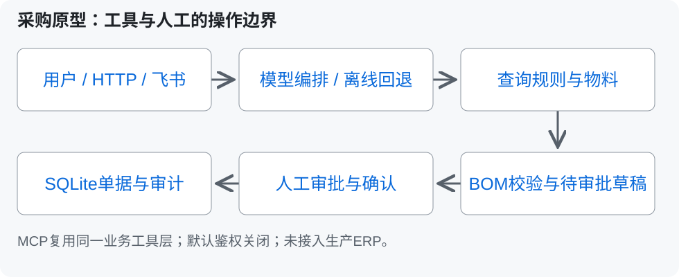

# 外贸采购 Agent

[](https://github.com/qiandewucimi-cpu/erp-procurement-agent/actions/workflows/ci.yml)
[](LICENSE)

**从 BOM 到采购草稿：模型编排工具，确定性代码核对金额，人工确认后写入。**

项目源于外贸 ERP 实习中的物料、单耗、金额与字段兼容问题。原型使用合成数据和 SQLite，展示采购流程的验收与操作边界，**未接入生产 ERP**。

[当前界面实测](docs/ui-demo-2026-10-22.md) · [5 分钟操作脚本](docs/面试演示_5分钟.md) · [验证索引](docs/验证索引.md) · [运行详解](docs/运行与设计详解.md)

## 看看效果

**[64 秒真实工具执行回放](docs/demo/README.md)**：正常 BOM、权限拒绝、异常阻断、审批、确认与幂等。合成数据，无模型调用；这是执行结果回放，不是聊天界面录屏。




当前UI已实测正常草稿、确认写入、重复确认和异常阻断；独立数据库最终只有一张 ¥24,164 采购单。该UI验证未启用模型或鉴权，角色分离另由开启鉴权的冒烟脚本验证。[本次截图与证据](docs/ui-demo-2026-10-22.md) · [2026年9月历史模型界面](docs/ui-demo.md)

## 我的贡献

我负责业务流程梳理、对象与操作边界定义、验收场景和实际测试反馈；代码使用 AI 开发工具辅助实现。项目中的 Ontology 指“对象—关系—动作”的业务建模方法，没有使用或部署 Palantir Foundry。

## 如何工作



[架构图源码](docs/architecture-overview.mmd)

| 设计 | 实现与边界 |
|---|---|
| 模型编排 | Function Calling 调用 8 个工具；无模型配置时使用标注清楚的确定性回退 |
| 金额与业务校验 | 在工具/工作流代码中执行，模型不直接计算金额；仍需验证输入、精度与业务规则 |
| 权限与审批 | **默认 `ERP_AUTH_ENABLED=false`，仅便于本地演示**。开启后绑定 viewer/operator/approver，检查角色与发起/审批分离 |
| 幂等与审计 | SQLite 事务与 action_id 唯一约束；不能据此推断远端 ERP 的幂等语义 |
| 集成 | 提供 HTTP Adapter 契约、MCP 与飞书入口；生产接入需要单独联调和验收 |

确认口令用于表达操作意图，不能替代身份鉴别。各入口配置见 [权限说明](docs/权限与审批状态机.md)；MCP 使用配置的固定身份，飞书需绑定用户身份，HTTP 使用 Bearer Token。

## 快速开始

使用 Python 3.11 或 3.12，在仓库根目录执行：

```bash
python -m venv .venv
# Windows: .venv\Scripts\activate
# macOS / Linux: source .venv/bin/activate
python -m pip install -r requirements.txt
python smoke_interview.py
```

`smoke_interview.py` 使用临时数据库与合成 BOM，无需模型密钥；检查正常草稿、金额、权限、审批、重复确认、异常阻断与指标。

Windows 启动界面：

```powershell
.\start_demo.cmd
```

其他平台分别在两个已激活环境的终端运行：

```bash
python -m uvicorn api:app --host 127.0.0.1 --port 8000
python -m streamlit run ui.py
```

访问 UI `http://127.0.0.1:8501` 与 API `http://127.0.0.1:8000/docs`。需要真实模型时参考 `.env.example` 配置；查看页面模型状态，区分模型编排与离线回退。[Docker、MCP、飞书与接口详情](docs/运行与设计详解.md)

## 验证

```bash
python -m unittest discover -s tests -v
python evals/run_eval.py --offline
python evals/run_rag_eval.py
```

- CI 运行单元测试、离线确定性场景、RAG 评测与覆盖率报告；绿色 CI 不代表执行了真实模型全量评测。
- [历史全量报告](evals/REPORT.md)记录 2026-09-13 的 **25 条确定性 + 15 条模型场景，40/40 通过**。模型结果是一次运行快照，不是普遍安全保证。
- RAG 结果仅适用于仓库内合成知识库。具体命令、来源与局限见 [验证索引](docs/验证索引.md)。

## 已知限制

- 鉴权默认关闭；在共享环境使用前必须配置身份与角色并验证对应入口。
- 会话上下文保存在进程内存中；重启、多实例、跨用户隔离需要进一步验证与设计。
- 金额仍使用 float / SQLite REAL 和两位小数舍入；未实现生产财务精度、多币种精度与汇率规则。
- 真实 ERP 的超时后查单、跨系统幂等、补偿和权限映射尚待客户测试环境验收。
- 确定性校验降低特定风险，不保证任意模型输出、输入或程序缺陷均不会导致错误操作。

## 深入阅读

[需求与痛点](docs/01_需求发现与业务痛点.md) · [范围](docs/02_需求范围与非目标.md) · [架构决策](docs/03_架构决策记录_ADR.md) · [Adapter 契约](docs/ERP_Adapter契约.md) · [故障排查](docs/07_故障排查手册.md) · [试点与回滚](docs/08_试点上线与回滚方案.md)

[项目状态](PROJECT_STATUS.md) · [项目复盘](docs/09_项目复盘与面试问答.md) · [MIT License](LICENSE)
