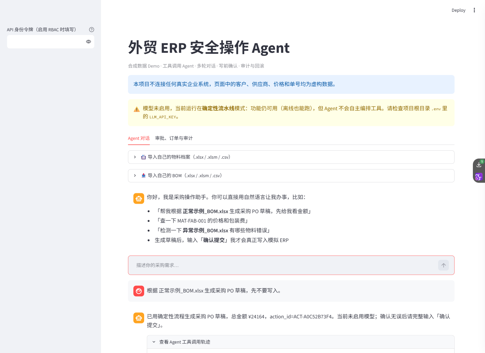
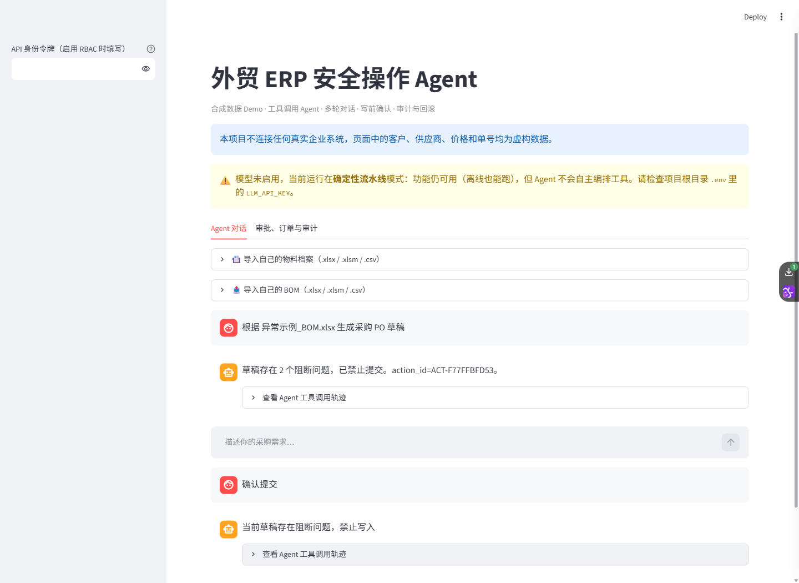
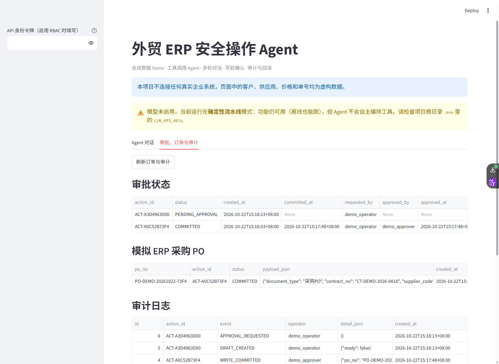

# 当前聊天界面实际验收

日期：2026-10-22（北京时间）。Python 3.12 / Streamlit 1.61.1，独立工作副本、合成样例和SQLite数据库。模型关闭、鉴权关闭；未调用外部模型，也没有接入生产ERP。

## 实际操作与结果

1. 浏览器打开Streamlit，顶部明确显示“模型未启用 / 确定性流水线”。
2. 输入“根据 正常示例_BOM.xlsx 生成采购 PO 草稿，先不要写入”，得到3行、总额 ¥24,164 的草稿。
3. 输入“确认提交”，得到采购单 `PO-DEMO-20261022-73F4`。
4. 再次输入“确认提交”，返回同一张采购单；回读 `/orders`，最终订单数量仍为1。
5. 异常BOM生成阻断草稿，再次确认得到“当前草稿存在阻断问题，禁止写入”；订单数量保持1。
6. 切换“审批、订单与审计”，查看订单与审计；标签切换现在触发重新渲染，修复首次进入时表格挤成窄列的问题。

截图为浏览器在实际交互时捕获的界面，未拼接或重绘UI；Streamlit自身滚动容器使截图展示的是当前可见区域，不称为整页完整长截图。它们是操作快照，不是连续录屏。[实际订单与审计JSON](ui-demo/2026-10-22-ui-verification.json)保留对应单号、金额和事件。

## 如何复现

安装依赖后运行 `python smoke_interview.py`，再按[README启动步骤](../README.md#快速开始)启动界面。不配置 `LLM_BASE_URL`；确认页面顶部显示模型未启用。使用仓库合成样例，按上述指令操作。重新运行会生成不同的action_id、时间和采购单号。

RBAC职责分离由 `smoke_interview.py` 使用独立模拟角色验证；本页默认无鉴权UI不能证明企业身份认证或发起/审批分离。上传文件保存在运行服务的机器；启用外部模型后，问题和工具结果可能发送给模型服务。
